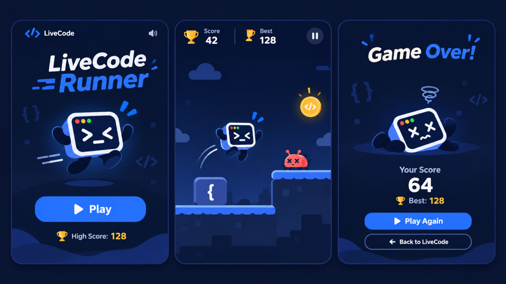

# LiveCode Runner

A short, coding-themed break-time mini-game made for **LiveCode**, a web app that teaches beginner programmers how code runs through step-by-step visual animations.

LiveCode's terminal-window mascot runs through a world of stray braces and bugs. You can jump over them in **Classic Runner**, or type them away in **Syntax Rush**. A run takes a minute or two, so it fits between two coding exercises.



---

## Table of contents

- [Game modes](#game-modes)
- [Controls](#controls)
- [Tech stack](#tech-stack)
- [Getting started](#getting-started)
- [Scripts](#scripts)
- [Project structure](#project-structure)
- [Architecture](#architecture)
- [Tuning the game](#tuning-the-game)
- [Testing](#testing)
- [Design specs](#design-specs)
- [Contributing](#contributing)

---

## Game modes

### Classic Runner (all devices)

An endless runner. The mascot runs forward on its own and you make it jump.

- **Obstacles:** stray `{` brace tiles and small bug enemies.
- **Raised platforms:** once a run reaches 150 points, raised blocks start to appear. Jump up onto them, run along the top, and drop off the end. Hitting a platform's side ends the run.
- **Difficulty:** the scroll speed goes up a little every second and stops at a fixed maximum, so the game never becomes unplayable.
- **Score:** distance survived, 10 points per second.
- **Works on phones:** the canvas scales to fit small screens, and tapping works the same as a key press.

### Syntax Rush (desktop only)

A typing mode. Bugs walk toward the mascot, each carrying a letter or a whole programming keyword. Type it before the bug reaches you.

- **Letters and keywords:** single letters `a`–`z`, plus C and Python keywords such as `if`, `while`, `def`, `printf`, `return` and `continue`. Longer words show up later in a run.
- **Word typing:** typed letters fade out, and the next letter is shown in gold with a caret under it. A typo breaks your combo but keeps your progress in the word.
- **Lives:** you start with 3 hearts. A bug that reaches you takes one, then a short slow-motion grace period follows.
- **Score:** distance, plus 10 points for every character you destroy (the word `function` gives 80).
- **Stats:** the Game Over screen shows your **WPM** and **accuracy**.
- **Gate:** Syntax Rush needs a real keyboard. It only unlocks on a device with a mouse or trackpad and a window at least 1024 px wide. Everywhere else, Play starts Classic Runner.

Each mode keeps its own **best score** in `localStorage`. There are no accounts and no backend.

---

## Controls

| Action        | Classic Runner                  | Syntax Rush                    |
| ------------- | ------------------------------- | ------------------------------ |
| Jump / type   | `Space`, `↑`, click or tap      | Type the letter or word shown  |
| Pause / resume| `Esc`, `P`, or the pause button | `Esc` or the pause button      |
| Auto-pause    | When the tab or window loses focus | Same                        |

The Game Over screen ignores input for its first 400 ms, so a jump you were still mashing when you died doesn't press **Play Again** by accident.

---

## Tech stack

| Area            | Choice                                                    |
| --------------- | --------------------------------------------------------- |
| Build tool      | [Vite](https://vite.dev)                                  |
| UI              | [React 19](https://react.dev) + TypeScript (strict)       |
| Styling         | [Tailwind CSS v4](https://tailwindcss.com) (menus, HUD, buttons) |
| Game rendering  | Plain HTML5 Canvas + `requestAnimationFrame`, no game engine |
| State           | [Zustand](https://zustand.docs.pmnd.rs)                   |
| Sound           | Web Audio API, generated in code (no audio files, no library) |
| Tests           | [Vitest](https://vitest.dev)                              |
| Lint            | [Oxlint](https://oxc.rs)                                  |

The game is kept small on purpose, so the main LiveCode app can lazy-load it as its own route or chunk.

---

## Getting started

**Requirements:** Node.js 20.19+ or 22.12+ (needed by Vite 8) and npm.

```bash
git clone https://github.com/BaxromBobokulov/LiveCode-Game.git
cd LiveCode-Game
npm install
npm run dev
```

Then open the local URL Vite prints (usually `http://localhost:5173`).

---

## Scripts

| Command              | What it does                                         |
| -------------------- | ---------------------------------------------------- |
| `npm run dev`        | Starts the dev server with hot reload                |
| `npm run build`      | Type-checks (`tsc -b`) and builds for production into `dist/` |
| `npm run preview`    | Serves the production build locally                  |
| `npm test`           | Runs the unit tests once                             |
| `npm run test:watch` | Runs the unit tests in watch mode                    |
| `npm run lint`       | Lints the code with Oxlint                           |

> **Windows note:** run the tests from PowerShell or `cmd`. They are known to fail when run from Git Bash in this repo.

---

## Project structure

```txt
src/
  engine/              Pure game logic: no React, no DOM, no canvas
    types.ts           Shared types (entities, obstacles, platforms, modes)
    physics.ts         Gravity, jump, landing
    terrain.ts         Raised platforms: floor lookup and wall hitboxes
    spawner.ts         Obstacle and platform spawning, difficulty curve
    collision.ts       Hit detection between the mascot and obstacles
    score.ts           Score from time survived
    viewport.ts        How the world scales to the screen size
    syntaxRush.ts      Syntax Rush: picking letters and words, key matching, WPM, accuracy
  features/game/
    MainMenu.tsx       Title screen and mode buttons
    GameCanvas.tsx     Classic Runner canvas and game loop
    Hud.tsx            Classic Runner score, best score and pause overlay
    GameOverScreen.tsx Classic Runner results
    SyntaxRushCanvas.tsx / SyntaxRushHud.tsx / SyntaxRushGameOver.tsx
    useCanPlaySyntaxRush.ts  Checks for a keyboard and a wide enough window
  store/gameStore.ts   Zustand store: status, mode, score, best scores, lives, combo
  lib/
    storage.ts         Best score read/write in localStorage (never throws)
    sound.ts           Sound effects made with Web Audio
  constants/game.ts    Every tuning value in one place
  components/          Shared UI: Button, ScoreBadge, inline SVG icons
  assets/              Mascot poses, obstacle sprites, background art
docs/
  specs/               Design specs, one folder per feature
  reviews/             Code review notes
```

---

## Architecture

The code has two layers, and the line between them is kept on purpose:

1. **`src/engine/` is pure TypeScript.** Every mechanic (gravity, collisions, spawning, scoring, key matching) is a function that takes plain objects and returns new ones. Units are pixels and seconds. Any function that needs randomness takes a `random` argument, so tests can pass in a fixed value. You can read `collision.ts` or `spawner.ts` on its own and understand that mechanic without touching the rendering code.
2. **React components draw and handle input.** `GameCanvas.tsx` and `SyntaxRushCanvas.tsx` own the canvas and the `requestAnimationFrame` loop. They call into the engine every frame and keep the positions of moving things in a ref, not in React state, so a 60 fps loop never causes a re-render.

**State.** One Zustand store holds only what the screens need: `status` (`menu` / `playing` / `paused` / `gameover`), `mode`, `score` and the best scores. The score is pushed to the store only when its whole number changes. Components read the store one value at a time through selectors, so a score update re-renders only the small score component.

**Run lifecycle.** Screens start and leave a run through store actions (`startGame`, `startSyntaxGame`, `pauseGame`, `resumeGame`, `resetToMenu`). The canvas watches `status` and reacts to it. Paused time is never counted, and a run you quit doesn't count toward your best score.

**Design tokens.** Colors and fonts are defined once in the `@theme` block of [`src/index.css`](src/index.css) and used as Tailwind classes. The canvas reads the same CSS variables once when it mounts.

See [AGENTS.md](AGENTS.md) for the full set of conventions.

---

## Tuning the game

All gameplay values live in [`src/constants/game.ts`](src/constants/game.ts), each with a comment that gives its unit and the reason for its value. For example:

| Constant              | Meaning                                       |
| --------------------- | --------------------------------------------- |
| `GRAVITY`, `JUMP_FORCE` | How the jump feels                          |
| `BASE_SPEED`, `SPEED_INCREASE_RATE`, `MAX_SPEED` | Classic Runner difficulty curve |
| `SPAWN_INTERVAL_MIN` / `MAX` | Time between obstacles               |
| `PLATFORM_MIN_SCORE`, `PLATFORM_CHANCE` | When and how often platforms appear |
| `SYNTAX_*`            | Syntax Rush speed, spawn gaps, lives, grace period |
| `SYNTAX_WORDS_TIER_1` / `TIER_2` | The keyword lists              |

Some tests check fairness rules, for example "every obstacle can be jumped at top speed" and "every word stays on screen long enough to type". If you change a value and one of these tests fails, the change made the game unfair.

---

## Testing

The unit tests cover the pure engine, the store and the `lib/` helpers. They run in a Node environment, with no browser and no canvas mocks.

```bash
npm test
```

Test files sit next to the code they test (`*.test.ts`), for example `src/engine/collision.test.ts`.

---

## Design specs

Larger features are designed before they are built. Each one gets a spec in [`docs/specs/`](docs/specs/) that lists its acceptance criteria and explains the decision:

| Spec | Feature |
| ---- | ------- |
| [0001](docs/specs/0001-ground-elevation-platforms/index.md) | Raised ground platforms in Classic Runner |
| [0002](docs/specs/0002-syntax-rush-mode/index.md) | Syntax Rush typing mode |
| [0003](docs/specs/0003-syntax-rush-word-obstacles/index.md) | Keyword obstacles in Syntax Rush |

---

## Contributing

1. Read [AGENTS.md](AGENTS.md) first. It explains the project's scope, structure and constraints.
2. Keep game logic in `src/engine/` and cover it with tests.
3. Ask before adding a new dependency (a game engine, a sound library, an animation library and so on).
4. Before opening a pull request, run `npm run lint`, `npm test` and `npm run build`.

Out of scope for v1: multiplayer, online leaderboards, user accounts, 3D/WebGL and physics engines.
